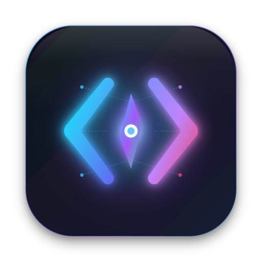
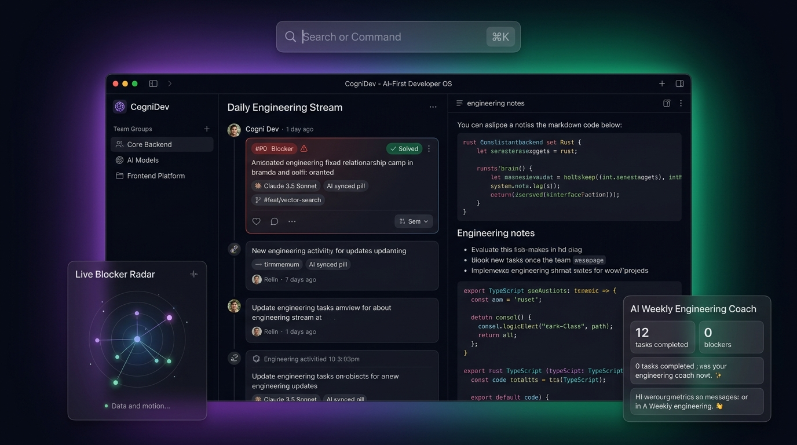
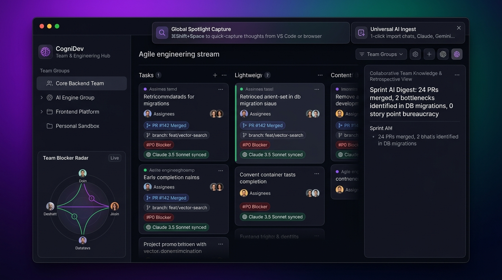
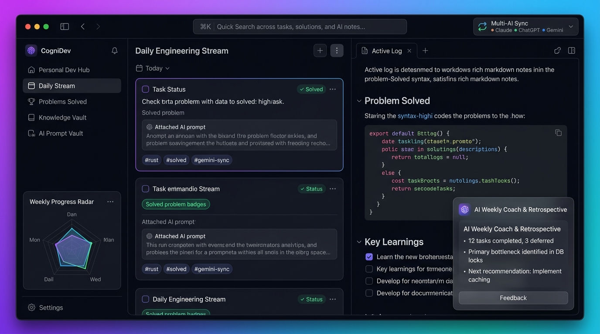
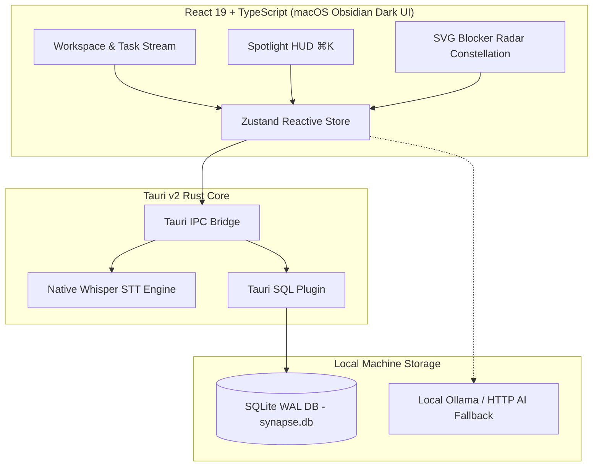

<div align="center">



# ⚡️ CogniDev
### AI-First Developer Operating System for macOS

<p align="center">
  <strong>A distraction-free, local-first engineering workspace that centralizes multi-model AI insights, tracks daily flow, and manages squads without Jira bloat.</strong>
</p>

[](https://tauri.app/)
[](https://react.dev/)
[](https://www.rust-lang.org/)
[](https://www.typescriptlang.org/)
[](https://www.sqlite.org/)
[](https://apple.com/)
[](LICENSE)

<br />



<br />
</div>

---

## 💡 Why CogniDev?

As modern engineers, we spend hours brainstorming solutions with **Gemini, Claude, ChatGPT, and local Ollama models**. However:
- ❌ **Fragmented Brain**: Breakthrough architectures and bug resolutions remain stranded across browser chat tabs.
- ❌ **Jira & Agile Fatigue**: Traditional project management tools are bogged down by story-point poker, hour tracking, and slow web UIs.
- ❌ **Lost Context**: Engineering notes and solutions don't connect with the AI prompt that actually solved the problem.

**CogniDev solves this.** It is a native macOS desktop application engineered with **Tauri v2, Rust, and React 19** that serves as your single engineering cockpit.

---

## ✨ Core Pillars & Features

### 1. 🤖 Universal AI Prompt & Context Ingestion
Stop copying and losing code snippets. Paste raw chat logs or summaries from any AI model directly into CogniDev.

* **Heuristic Parser**: Automatically parses problem statements, extracted code blocks, and key takeaways.
* **Bi-Modal Storage**: Save as a fresh *Solved Card* or attach as engineering context to an existing task.
* **Prompt Vault**: Preserves the exact prompt hash, AI response, and model tag for instant recall.

---

### 2. 👥 Team Groups (Squads) & Live Blocker Radar
A radical alternative to heavy enterprise issue trackers.

<div align="center">
  
</div>

* **Zero-Bureaucracy Squads**: Organize tasks by domain (`⚡️ Core Backend`, `🎨 Frontend Platform`, `🤖 AI Infrastructure`).
* **Live Blocker Radar**: A real-time visual constellation graph identifying **P0 Blockers** across team members before sprint velocity drops.
* **SQLite v3 Schema**: Relational squad management with local-first foreign key constraints and zero cloud latency.

---

### 3. 🎯 macOS Spotlight HUD (`⌘K`)
Designed specifically for keyboard-first developers.

* **Global Spotlight (⌘K)**: Trigger a Raycast/Alfred-style HUD anywhere to search tasks or quick-capture thoughts.
* **Inline Dictation**: Voice-to-note transcription for swift audio capture during review sessions.

---

### 4. 🧠 AI Weekly Engineering Coach & Automated Retrospectives

<div align="center">
  
</div>

* **Automated Standups**: Synthesizes yesterday's completions, today's queue, and active blockers with 1 click.
* **Weekly Engineering Coach**: Intelligently analyzes completed vs. deferred tasks, highlights technical bottlenecks (e.g., DB locks, API limits), and produces actionable sprint recommendations.
* **Local AI Execution**: First-class support for offline models via local Ollama (`qwen2.5-coder`, `llama3`).

---

## 🏛 Architecture



---

## ⌨️ Keyboard Shortcuts

| Shortcut | Action | Scope |
|---|---|---|
| `⌘K` / `Ctrl+K` | Open macOS Spotlight HUD (Search / Quick Capture) | Global |
| `Escape` | Dismiss modal / Close active overlay | Global |
| `Enter` | Submit Quick Capture input bar | Daily Stream |
| `⌘D` | Toggle Voice Dictation recording | Task Editor |

---

## 🛠 Tech Stack

| Component | Technology | Description |
|---|---|---|
| **Runtime** | [Tauri v2](https://tauri.app/) (Rust) | Lightweight (~15MB), secure native desktop container |
| **Frontend** | [React 19](https://react.dev/) + [TypeScript](https://www.typescriptlang.org/) | Concurrent UI rendering with strict type safety |
| **State** | [Zustand](https://github.com/pmndrs/zustand) | Minimalistic, reactive state management |
| **Database** | [SQLite](https://www.sqlite.org/) (WAL mode) | Local-first persistence via `@tauri-apps/plugin-sql` |
| **Styles** | [Tailwind CSS](https://tailwindcss.com/) | Curated obsidian-dark theme with glassmorphic accents |
| **Icons** | [Lucide React](https://lucide.dev/) | Consistent, clean iconography |

---

## 🚀 Getting Started

### Prerequisites

Ensure you have installed:
* **Node.js** (v18.0 or newer)
* **Rust** & Cargo (`curl --proto '=https' --tlsv1.2 -sSf https://sh.rustup.rs | sh`)
* **macOS** (macOS 12 Monterey or newer recommended)

### Quick Installation

```bash
# 1. Clone the repository
git clone https://github.com/Farhodoff/CogniDev.git
cd CogniDev

# 2. Install dependencies
npm install

# 3. Run in desktop development mode (Tauri + Vite)
npm run tauri dev
```

### Production Build

To compile a native macOS `.dmg` or `.app` bundle:

```bash
npm run tauri build
```

---

## 📂 Project Structure

```text
CogniDev/
├── docs/
│   └── images/               # High-res UI mockups and showcase captures
│       ├── cognidev-hero-showcase.jpg
│       ├── cognidev-squads-radar.jpg
│       └── cognidev-stream-notes.jpg
├── src-tauri/                 # Native Rust backend
│   ├── src/
│   │   ├── main.rs           # Native commands & STT engine
│   │   ├── migrations.sql    # v1 core schema
│   │   ├── migrations2.sql   # v2 prompt vault & retro schema
│   │   └── migrations3.sql   # v3 team groups & squad foreign keys
│   └── Cargo.toml            # Rust dependencies
├── src/                      # React 19 Frontend
│   ├── components/
│   │   ├── SpotlightModal.tsx      # macOS Spotlight HUD (⌘K)
│   │   ├── WeeklyCoachModal.tsx    # AI Engineering Coach & Retrospectives
│   │   ├── LogChatModal.tsx        # Universal Multi-AI Ingest Modal
│   │   ├── TaskStream.tsx          # Daily Stream & Squad Filter
│   │   ├── WorkspaceEditor.tsx     # Syntax-highlighted Resolution Editor
│   │   └── Sidebar.tsx             # Squads & Live Blocker Radar
│   ├── lib/
│   │   ├── ai.ts             # Heuristic parser & coach intelligence engine
│   │   ├── db.ts             # SQLite queries & migrations
│   │   ├── store.ts          # Zustand state store
│   │   └── types.ts          # TypeScript domain definitions
│   └── App.tsx               # Root component & global shortcuts
├── package.json
└── README.md
```

---

## 📄 License

Distributed under the **MIT License**. Created with ❤️ by [Farhod](https://github.com/Farhodoff).
