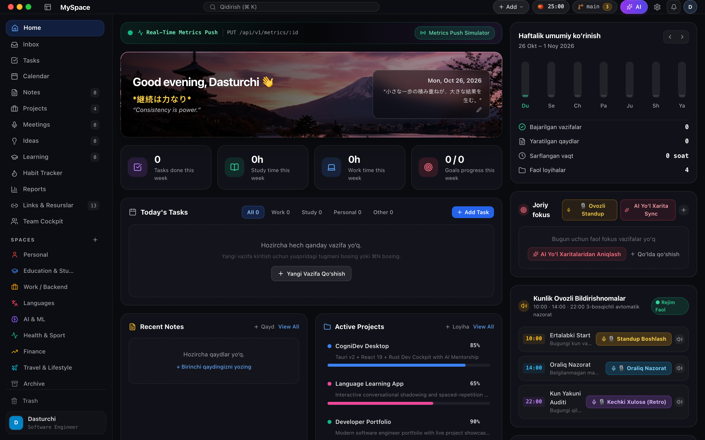
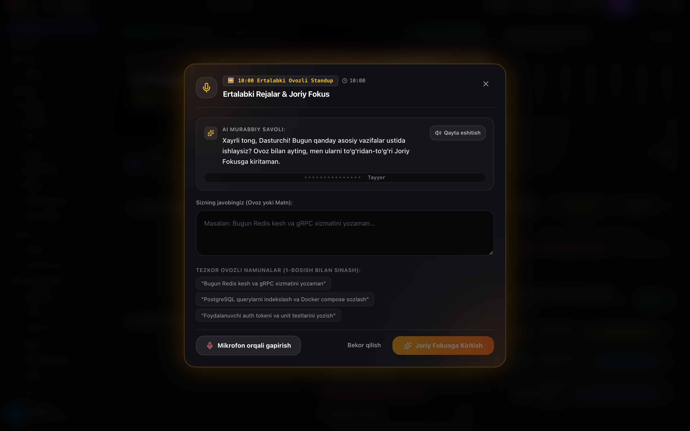
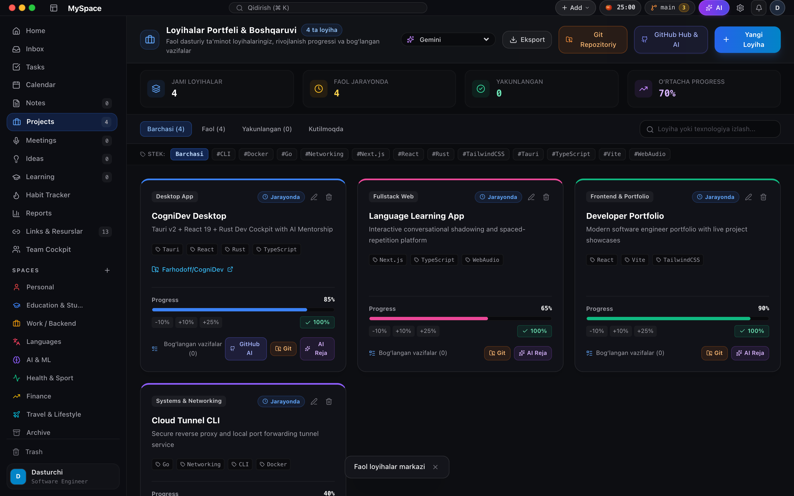
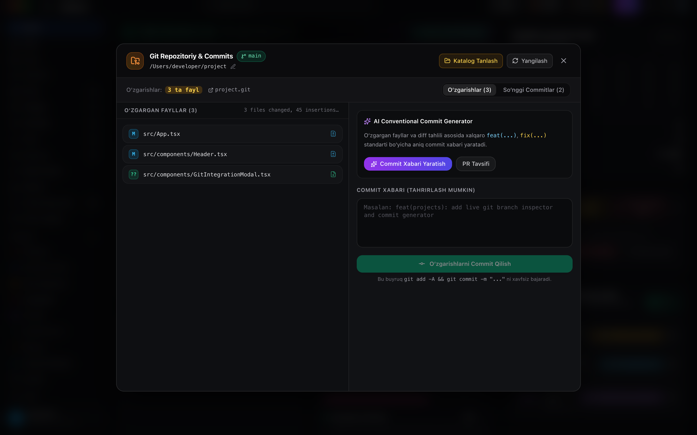

<div align="center">


# ⚡️ CogniDev
### AI-Powered Developer Command Center & Cockpit for macOS

<p align="center">
  <strong>Dasturchilar uchun chalg'itmaydigan, mahalliy (local-first) boshqaruv markazi: o'zbekcha ovozli AI standup, loyihalar va vazifalar oqimi, Git tahlili hamda chuqur fokus vositalari.</strong>
</p>

[](https://tauri.app/)
[](https://react.dev/)
[](https://www.rust-lang.org/)
[](https://www.typescriptlang.org/)
[](https://www.sqlite.org/)
[](https://apple.com/)
[](https://github.com/Farhodoff/CogniDev/actions/workflows/ci.yml)
[](https://farhodoff.github.io/CogniDev/)
[](LICENSE)

<br />



<br />
</div>

---

## 🎙️ O'zbek Tili STT Modelini O'rnatish (2 xil usul)

CogniDev mahalliy ovozli yozuv va nutqni matnga aylantirish (STT) uchun **whisper.cpp** dvigateli hamda o'zbek tiliga moslashtirilgan **`rubaiSTT v2 medium`** modelidan (`ggml-rubaistt.bin` — ~785 MB) foydalanadi.

Har bir foydalanuvchi o'ziga qulay usulni tanlashi mumkin:

### 1-usul: GitHub Releases orqali tayyor ilovani yuklab olish (Tavsiya etiladi)
Eng oson yo'li — loyihaning Releases bo'limidan tayyor macOS paketini (`.dmg`) yuklab olish. Bunda barcha modellar va sozlamalar tayyor holda biriktirilgan bo'ladi:
* 📦 **[CogniDev GitHub Releases Sahifasi](https://github.com/Farhodoff/CogniDev/releases)**

---

### 2-usul: Modelni alohida yuklab olish (Mustaqil o'rnatish yoki Development)
Agar loyihani manba kodidan (`git clone`) ishlatayotgan bo'lsangiz yoki model faylini alohida yuklab olmoqchi bo'lsangiz:

* **⚡️ To'g'ridan-to'g'ri yuklab olish havolasi (Direct Download):**  
  [ggml-rubaistt.bin (GitHub Release - 785 MB)](https://github.com/MuhammadMirrr/uzbek-dictation/releases/download/v1.0/ggml-rubaistt.bin)
* **🤗 Hugging Face sahifasi (Asl model):**  
  [islomov/rubaistt_v2_medium](https://huggingface.co/islomov/rubaistt_v2_medium)

**Terminal orqali 1 qatorlik tezkor yuklab olish buyrug'i:**
```bash
mkdir -p ~/.cognidev/models
curl -L -o ~/.cognidev/models/ggml-rubaistt.bin \
  https://github.com/MuhammadMirrr/uzbek-dictation/releases/download/v1.0/ggml-rubaistt.bin
```

> **Eslatma:** Ilova modelni avtomatik ravishda `~/.cognidev/models/ggml-rubaistt.bin` yoki `~/rubai-stt/models/ggml-rubaistt.bin` yo'llaridan topib ishga tushiradi.

---

## 🌟 To'liq Imkoniyatlar & Modullar (All Features)

### 1. 🎙️ Mahalliy O'zbekcha Ovozli Standup & AI Meetings
Ovoz bilan fikrlarni, rejalarni va kundalik hisobotlarni yozish. Barcha hisoblashlar to'g'ridan-to'g'ri kompyuteringizning o'zida (Apple Silicon Metal / CPU) amalga oshadi, ovoz hech qanday tashqi serverga yuborilmaydi.

<div align="center">
  
</div>

* **Kunlik 3 bosqichli standup**:
  * 🌅 `10:00` — **Ertalabki Start**: Bugungi asosiy vazifalar va rejalarni belgilash.
  * ☀️ `14:00` — **Oraliq Nazorat**: Kun o'rtasidagi progress va kutilmagan to'siqlar auditi.
  * 🌙 `22:00` — **Kun Yakuni (Retro)**: Bajarilgan ishlarni sarhisob qilish va ertangi kunga fokus qoldirish.
* **AI Murabbiy ovozli savollari**: Gapirishingiz bilan ovoz sekund ichida matnga aylanadi va to'g'ridan-to'g'ri **Joriy Fokus** ro'yxatiga tushadi.
* **AI Meetings (Uchrashuvlar audio yozuvi & tahlili)**:
  * Uchrashuvlarni bevosita mikrofondan yozib olish yoki audio fayl (`.wav`, `.mp3`, `.m4a`) yuklash.
  * To'liq avtomatik transkript, asosiy konspekt va bajarilishi kerak bo'lgan vazifalar (Action Items) ekstraksiyasi.

---

### 2. 📂 Loyihalar Portfeli & AI Git Inspector (`⌘J`)
Dasturchining barcha faol repositoriyalarini va rivojlanish progressini bir joyda boshqarish.

<div align="center">
  
</div>

* **Loyihalar boshqaruvi**: Har bir loyiha uchun progress bar (0–100%), stek teglari (`#Rust`, `#Tauri`, `#React`, `#Next.js`, `#Docker`, `#Go` va h.k.) hamda bog'langan vazifalar hisobi.
* **Git Inspector & AI Commit Generator (`⌘J`)**:
  * Mahalliy Git repozitoriyasidagi o'zgargan fayllar va diff tahlili.
  * Xalqaro Conventional Commits (`feat(...)`, `fix(...)`, `refactor(...)`) standarti bo'yicha aniq commit xabarlarini bitta tugma bilan yaratish va xavfsiz commit qilish.

<div align="center">
  
</div>

---

### 3. 📋 Vazifalar Oqimi (Task Stream), Inbox & Resolution Editor
Oddiy va chalg'itmaydigan vazifalar boshqaruvi:

* **Inbox (Kiruvchi quti)**: Xom g'oyalar, shoshilinch fikrlar va qaydlarni bir zumda yozib qoldirish (Triage).
* **Task Stream**: Holatlar (`Todo`, `In Progress`, `Blocked`, `Done`) va ustuvorliklar bo'yicha filtrlash (`P0 Blocker`, `High`, `Medium`, `Low`).
* **Resolution Editor**: Har bir vazifa uchun texnik yechim tafsilotlari, muammo ildizi (Root Cause) va kod parchalarini saqlash.

---

### 4. 📅 Kalendar & Vaqt Bloklari (Calendar Workspace)
Muhandislik vaqtingizni aniq rejalashtiring:
* Kunlik va haftalik vazifalar taqvimi.
* Deadlinelar, sprint muddatlari va Deep Work (uzluksiz kod yozish) bloklarini ko'rgazmali kuzatish.

---

### 5. 📝 Notion-uslubidagi Texnik Qaydlar (Notes Workspace)
* Texnik arxitektura hujjatlari, dasturlash qaydlari va muammolarni bartaraf etish qo'llanmalari.
* Markdown sintaksisi, sintaksis yorug'lantirish (syntax highlighting) va tezkor qidiruv.

---

### 6. 🎓 Texnologik Roadmap & O'rganish Jurnali (Learning)
Dasturchining professional o'sish xaritasi:
* Frontend, Backend, AI/ML, DevOps va yangi dasturlash tillari bo'yicha interaktiv bosqichli xaritalar.
* O'rganilgan mavzular, o'qilgan maqolalar va sertifikatlar progressini qayd etish.

---

### 7. 💡 G'oyalar Inkubatori (Ideas Workspace)
* Yangi startup, open-source yoki pet-project g'oyalarini to'plash.
* G'oyaning dolzarbligi, murakkablik darajasi va talab qilinadigan texnologiyalar teglari.

---

### 8. 🔥 Odatlar Nazorati & Consistency (Habit Tracker)
Dasturchining kunlik intizomini shakllantirish:
* Odatlar ro'yxati (masalan, *Code Review*, *LeetCode / Algoritm*, *Texnik kitob o'qish*, *Jismoniy mashq*).
* Kunlik bajarilishini belgilash, streak hisoblagichi va haftalik faollik issiqlik xaritasi (consistency heatmaps).

---

### 9. 📊 Hisobotlar va AI Haftalik Murabbiy (Reports & Retro)
* **Weekly Engineering Review**: Hafta davomida bajarilgan vazifalar, kechiktirilgan ishlar va sarflangan vaqt balansi.
* **AI Coach Tavsiyalari**: Kod tezligini oshirish, to'siqlarni yechish va sprint samaradorligini tahlil qilish.

---

### 10. 🔗 Dasturchi Resurslari & Havolalar Bazasi (Links)
* Tez-tez ishlatiladigan API hujjatlari, GitHub repo havolalari, server panellari va dasturlash vositalarini bir joyda saqlash va qidirish.
* Teglar va toifalar bo'yicha tartiblash.

---

### 11. 👥 Team Cockpit (Jamoaviy Standup)
* Jamoa a'zolari bilan sprint maqsadlari, joriy fokuslar va P0 to'siqlarni sinxronlashtirish.

---

### 12. 🏷️ Maydonlar (Spaces Konteksti)
Hayotingiz va ishingizni aniq chegaralarga ajrating:
* `💼 Work / Backend` — Asosiy ish va backend vazifalari.
* `🧠 AI & ML` — Neyrotarmoqlar va modellar ustida tajribalar.
* `🎓 Education & Study` — Yangi texnologiyalar va til o'rganish.
* `👤 Personal` — Shaxsiy ishlar va maqsadlar.
* *(Yangi shaxsiy maydonlarni xohlagan rang va ikonka bilan yaratish mumkin)*.

---

### 13. ⚡️ Klaviatura Yorliqlari & Chuqur Fokus Vositalari
* **Spotlight HUD (`⌘K`)**: Raycast/Alfred uslubidagi global tezkor buyruqlar va vazifalar qidiruvi.
* **Pomodoro & Deep Work taymeri (`⌘P`)**: Chalg'imasdan ishlash, orqa fon muhiti va ish vaqti hisobi.
* **AI Rubber Duck Debugger (`⌘D`)**: Kod xatoliklarini tushuntirish va muammoli joylarni aniqlash bo'yicha AI suhbatdoshi.
* **📡 Real-Time Metrics Push API**: `/api/v1/metrics` orqali tashqi skriptlardan ilovaga jonli metrikalarni yuborish imkoniyati.
* **📊 Haftalik Hisobot Eksporti (Excel / TXT)**: Haftalik bajarilgan vazifalar, to‘siqlar, fokus statistikasi va AI tahlilini bir zumda Microsoft Excel (`.csv`, UTF-8 BOM) yoki Matn (`.txt`) ko‘rinishida yuklab olish.
* **🔒 100% Local-First Maxfiylik**: Barcha ma'lumotlar mahalliy SQLite WAL bazasida saqlanadi. Istalgan paytda JSON orqali to'liq zaxira (Backup / Export) olish mumkin.

---

## ⌨️ Asosiy Klaviatura Yorliqlari (Hotkeys)

| Tugmalar | Vazifasi | Qayerda ishlaydi |
|---|---|---|
| `⌘K` / `Ctrl+K` | Spotlight buyruqlar paneli va tezkor qidiruv | Global |
| `⌘J` | CogniDev AI Assistant Drawer (O‘ng panel) | Asosiy oyna |
| `⌘P` | Pomodoro & Deep Work fokus taymeri oynasi | Asosiy oyna |
| `⌘D` | AI Rubber Duck Debugger (Muammolarni tahlil qilish) | Asosiy oyna |
| `⌘G` | GitHub Hub & AI Task Synthesizer oynasi | Asosiy oyna |
| `⌘⇧␣` (`Cmd+Shift+Space`) | macOS Menu Bar Spotlight Tezkor Qayd (Quick Capture) | Global OS |
| `Esc` | Ochiq modal yoki panelni yopish | Global |

---

## 🛠 Texnologik Stek

| Qism | Texnologiya | Izoh |
|---|---|---|
| **Platforma** | [Tauri v2](https://tauri.app/) (Rust) | Xavfsiz, yengil (~15MB) va mahalliy macOS konteyneri |
| **Frontend** | [React 19](https://react.dev/) + [TypeScript](https://www.typescriptlang.org/) | Zamonaviy va qat'iy turlashtirilgan interfeys |
| **Holat boshqaruvi** | [Zustand](https://github.com/pmndrs/zustand) | Tezkor, reaktiv holat menejmenti |
| **STT Dvigateli** | [whisper.cpp](https://github.com/ggerganov/whisper.cpp) + [rubaiSTT v2](https://huggingface.co/islomov/rubaistt_v2_medium) | O'zbek tili uchun 100% oflayn nutqni matnga aylantirish |
| **Ma'lumotlar bazasi** | [SQLite](https://www.sqlite.org/) (WAL mode) | Barcha ma'lumotlar faqat kompyuteringizda saqlanadi |
| **Dizayn** | [Tailwind CSS](https://tailwindcss.com/) | macOS Obsidian Dark mavzusi va mikro-animatsiyalar |

---

## 🚀 Ishga Tushirish (Development)

### Talablar:
* **Node.js** (v18.0 yoki undan yangi)
* **Rust** & Cargo (`curl --proto '=https' --tlsv1.2 -sSf https://sh.rustup.rs | sh`)
* **macOS** 12 Monterey yoki undan yangi

```bash
# 1. Repozitoriyni klonlash
git clone https://github.com/Farhodoff/CogniDev.git
cd CogniDev

# 2. Bog'liqliklarni o'rnatish
npm install

# 3. Modelni yuklab olish
mkdir -p ~/.cognidev/models
curl -L -o ~/.cognidev/models/ggml-rubaistt.bin \
  https://github.com/MuhammadMirrr/uzbek-dictation/releases/download/v1.0/ggml-rubaistt.bin

# 4. Desktop ilovani dev rejimida ishga tushirish
npm run tauri dev
```

### Production Build:
Native macOS `.dmg` paketini yaratish uchun:
```bash
npm run tauri build
```

---

## 📄 Litsenziya

**MIT License** asosida tarqatiladi. Yaratuvchi: [Farhod](https://github.com/Farhodoff).
